# Facade UI (free components)

[](https://mcptry.com/servers/io.github.marcoschulz7/facade)

Animated React components and page blocks for the websites of local businesses, real estate firms and agencies.
Built for Next.js, Tailwind v4 and shadcn. This repository holds the 35 free items, MIT licensed.
The full library with 24 Pro items, docs with live previews and the MCP server lives at **[facadeui.com](https://facadeui.com)**.

## Install

Any item installs into your own project with one command. You keep the source.

```bash
npx shadcn@latest add https://facadeui.com/r/open-now-badge.json
```

Or copy a file from `components/facade/` into your project. Every item depends only on `motion` and `lucide-react`
and uses semantic Tailwind tokens (`bg-background`, `text-muted-foreground`, `bg-brand`), so it follows your theme.
Add the four extra tokens from the [installation guide](https://facadeui.com/docs/installation) once.

## Use it with your AI agent

```bash
claude mcp add --transport http facade https://facadeui.com/api/mcp
```

Then: "Build a landing page for a plumbing company in Austin. Use Facade." The MCP server exposes
`list_components`, `get_component`, `get_install_command` and `suggest_page`. There is also an
[llms.txt](https://facadeui.com/llms.txt) and a Markdown version of every docs page.

## Components

### buttons

<a href="https://facadeui.com/components/magnetic-button">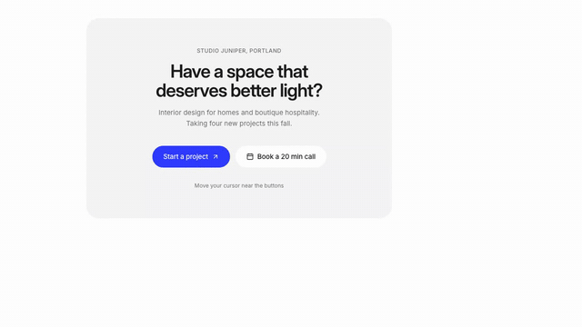</a>

**[Magnetic button](https://facadeui.com/components/magnetic-button)**  
Button that pulls toward the cursor with spring physics while its label drifts slightly further for depth.

```bash
npx shadcn@latest add https://facadeui.com/r/magnetic-button.json
```

<a href="https://facadeui.com/components/shine-button">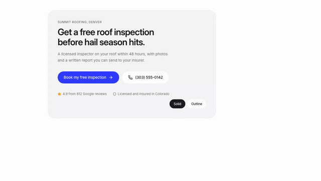</a>

**[Shine button](https://facadeui.com/components/shine-button)**  
Pill button with a soft light sweep on hover, three variants, three sizes and an arrow that nudges forward.

```bash
npx shadcn@latest add https://facadeui.com/r/shine-button.json
```

### text

<a href="https://facadeui.com/components/gradient-heading">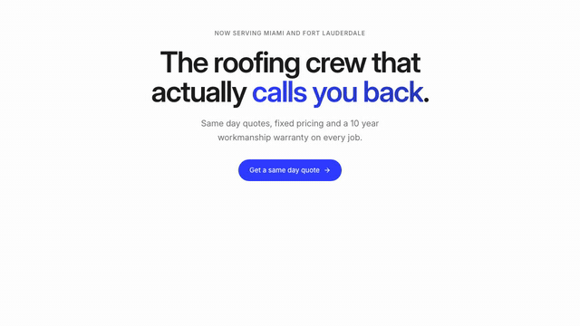</a>

**[Gradient heading](https://facadeui.com/components/gradient-heading)**  
Display heading with a slow brand gradient on highlighted words, or one soft brand pass through the whole line.

```bash
npx shadcn@latest add https://facadeui.com/r/gradient-heading.json
```

<a href="https://facadeui.com/components/text-reveal">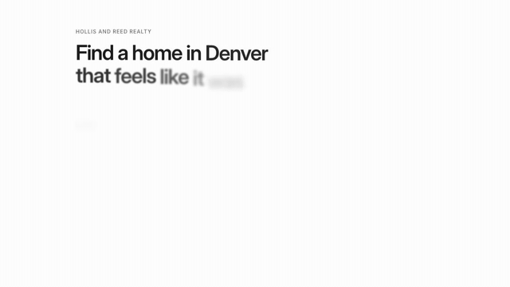</a>

**[Text reveal](https://facadeui.com/components/text-reveal)**  
Headline that reveals word by word with a blur, fade and gentle rise as it scrolls into view.

```bash
npx shadcn@latest add https://facadeui.com/r/text-reveal.json
```

### cards

<a href="https://facadeui.com/components/agent-card">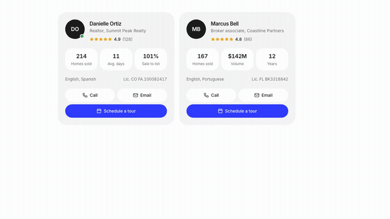</a>

**[Agent card](https://facadeui.com/components/agent-card)**  
Realtor contact card with initials avatar, rating, license, languages and call, email and tour actions.

```bash
npx shadcn@latest add https://facadeui.com/r/agent-card.json
```

<a href="https://facadeui.com/components/property-card">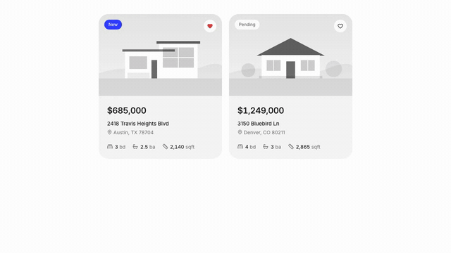</a>

**[Property card](https://facadeui.com/components/property-card)**  
Listing card with status badge, saved-home heart, price, address and beds, baths and square footage.

```bash
npx shadcn@latest add https://facadeui.com/r/property-card.json
```

<a href="https://facadeui.com/components/spotlight-card">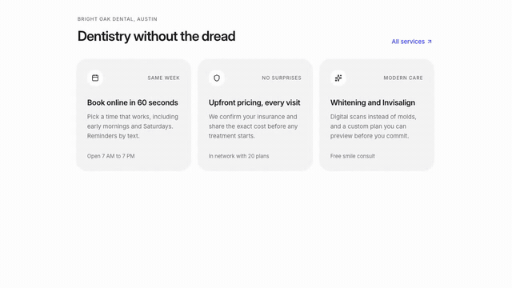</a>

**[Spotlight card](https://facadeui.com/components/spotlight-card)**  
Card with a soft radial spotlight and a glowing border that both follow the cursor.

```bash
npx shadcn@latest add https://facadeui.com/r/spotlight-card.json
```

### data

<a href="https://facadeui.com/components/animated-counter">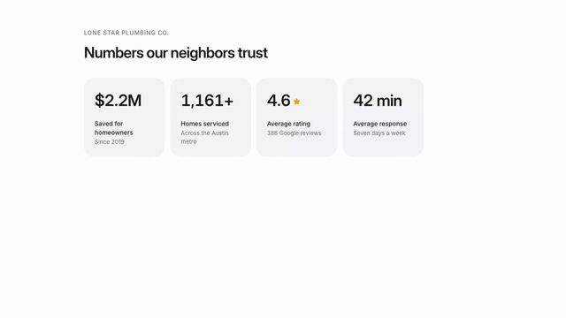</a>

**[Animated counter](https://facadeui.com/components/animated-counter)**  
Number that counts up when scrolled into view, with prefix, suffix, decimals and Intl formatting.

```bash
npx shadcn@latest add https://facadeui.com/r/animated-counter.json
```

<a href="https://facadeui.com/components/countdown">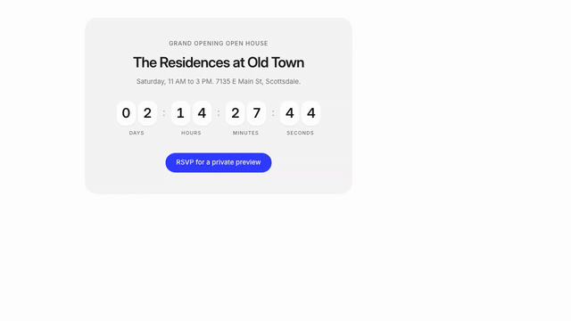</a>

**[Countdown](https://facadeui.com/components/countdown)**  
Countdown to an open house or launch with rolling flip digits for days, hours, minutes and seconds.

```bash
npx shadcn@latest add https://facadeui.com/r/countdown.json
```

<a href="https://facadeui.com/components/key-facts">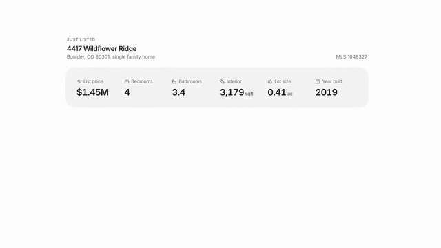</a>

**[Key facts](https://facadeui.com/components/key-facts)**  
Property key facts row with icons and numbers that count up when scrolled into view.

```bash
npx shadcn@latest add https://facadeui.com/r/key-facts.json
```

### forms

<a href="https://facadeui.com/components/listing-filters">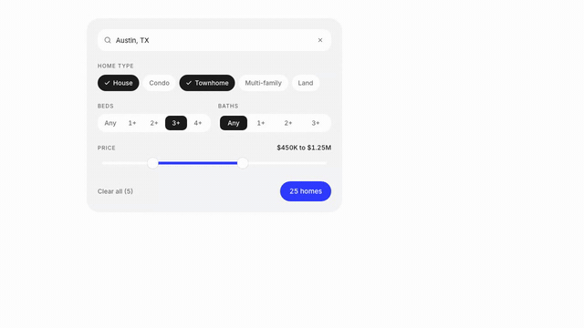</a>

**[Listing filters](https://facadeui.com/components/listing-filters)**  
Home search filters with location search, type chips, beds and baths, dual price slider and result count.

```bash
npx shadcn@latest add https://facadeui.com/r/listing-filters.json
```

<a href="https://facadeui.com/components/price-toggle">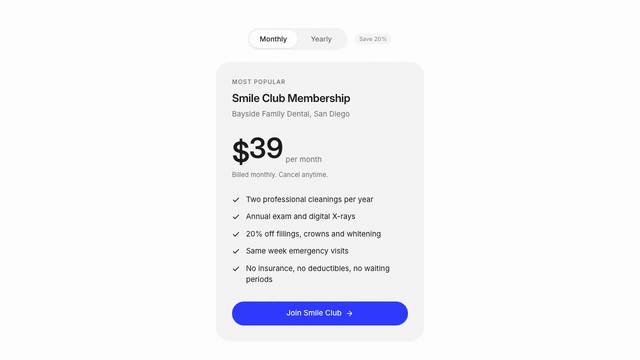</a>

**[Price toggle](https://facadeui.com/components/price-toggle)**  
Monthly or yearly segmented switch with a sliding thumb, plus an animated price that rolls its digits.

```bash
npx shadcn@latest add https://facadeui.com/r/price-toggle.json
```

### navigation

<a href="https://facadeui.com/components/sliding-tabs">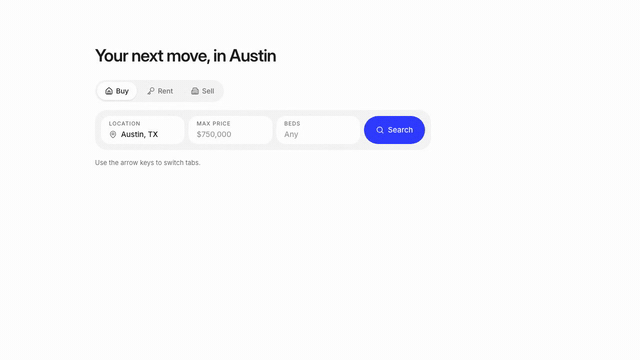</a>

**[Sliding tabs](https://facadeui.com/components/sliding-tabs)**  
Accessible tabs with a spring animated sliding pill, arrow key navigation and a soft content crossfade.

```bash
npx shadcn@latest add https://facadeui.com/r/sliding-tabs.json
```

<a href="https://facadeui.com/components/sticky-contact-bar">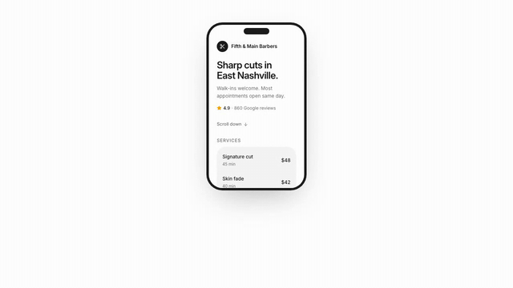</a>

**[Sticky contact bar](https://facadeui.com/components/sticky-contact-bar)**  
Mobile bottom bar with Call, Text, Directions and Book that hides on scroll down and returns on scroll up.

```bash
npx shadcn@latest add https://facadeui.com/r/sticky-contact-bar.json
```

### feedback

<a href="https://facadeui.com/components/announcement-bar">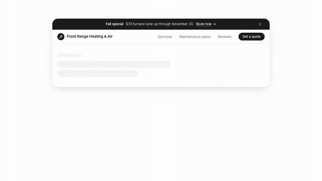</a>

**[Announcement bar](https://facadeui.com/components/announcement-bar)**  
Slim top bar that rotates promo messages with a link and collapses smoothly when dismissed.

```bash
npx shadcn@latest add https://facadeui.com/r/announcement-bar.json
```

<a href="https://facadeui.com/components/cookie-consent">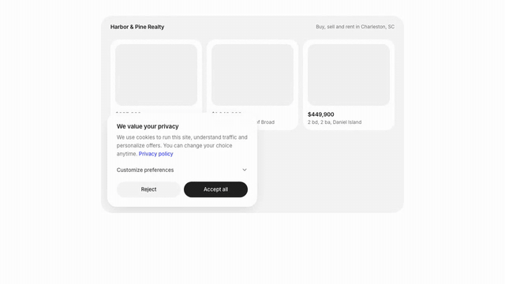</a>

**[Cookie consent](https://facadeui.com/components/cookie-consent)**  
Floating consent card with Accept all, Reject and customizable Analytics and Marketing toggles.

```bash
npx shadcn@latest add https://facadeui.com/r/cookie-consent.json
```

<a href="https://facadeui.com/components/promo-bar">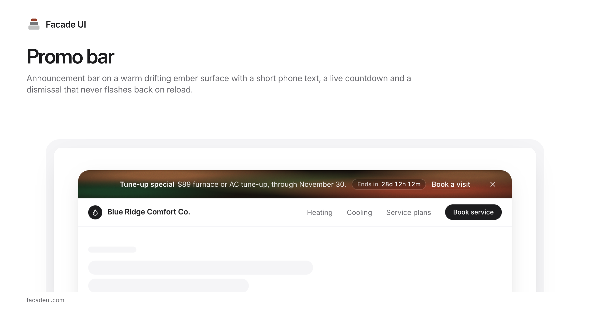</a>

**[Promo bar](https://facadeui.com/components/promo-bar)**  
Announcement bar on a warm drifting ember surface with a short phone text, a live countdown and a dismissal that never flashes back on reload.

```bash
npx shadcn@latest add https://facadeui.com/r/promo-bar.json
```

<a href="https://facadeui.com/components/star-rating">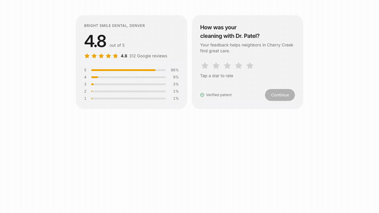</a>

**[Star rating](https://facadeui.com/components/star-rating)**  
Animated fractional star rating with review count, plus an accessible interactive input mode.

```bash
npx shadcn@latest add https://facadeui.com/r/star-rating.json
```

<a href="https://facadeui.com/components/urgency-badge">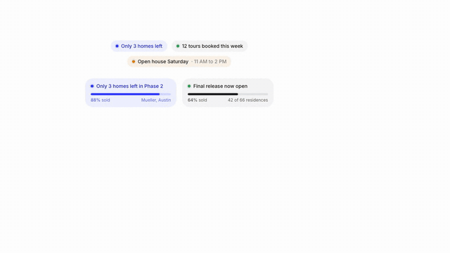</a>

**[Urgency badge](https://facadeui.com/components/urgency-badge)**  
Scarcity badge with a live dot and an optional percent sold bar that animates into view.

```bash
npx shadcn@latest add https://facadeui.com/r/urgency-badge.json
```

### layout

<a href="https://facadeui.com/components/ember-gradient">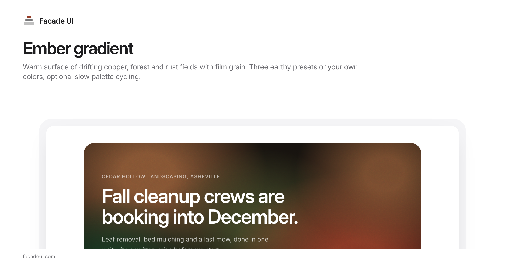</a>

**[Ember gradient](https://facadeui.com/components/ember-gradient)**  
Warm surface of drifting copper, forest and rust fields with film grain. Three earthy presets or your own colors, optional slow palette cycling.

```bash
npx shadcn@latest add https://facadeui.com/r/ember-gradient.json
```

<a href="https://facadeui.com/components/marquee">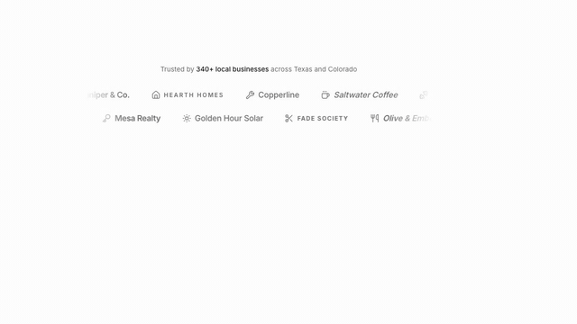</a>

**[Marquee](https://facadeui.com/components/marquee)**  
Seamless infinite marquee for logos or testimonials with faded edges, direction, speed and vertical mode.

```bash
npx shadcn@latest add https://facadeui.com/r/marquee.json
```

<a href="https://facadeui.com/components/reveal">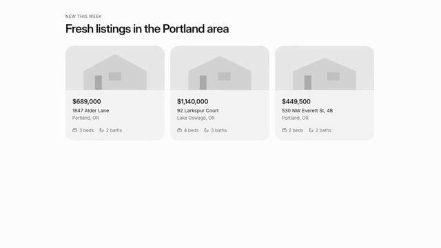</a>

**[Reveal](https://facadeui.com/components/reveal)**  
Scroll reveal wrapper with fade, rise, blur and scale presets plus a RevealGroup for staggered children.

```bash
npx shadcn@latest add https://facadeui.com/r/reveal.json
```

<a href="https://facadeui.com/components/smooth-accordion">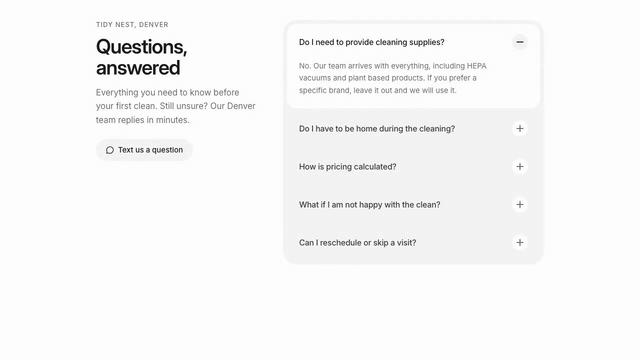</a>

**[Smooth accordion](https://facadeui.com/components/smooth-accordion)**  
Accessible FAQ accordion with smooth height animation, a plus to minus icon morph and single or multiple mode.

```bash
npx shadcn@latest add https://facadeui.com/r/smooth-accordion.json
```

### local business

<a href="https://facadeui.com/components/location-card">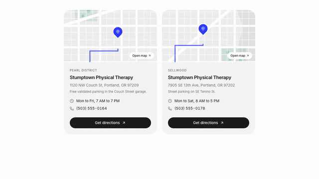</a>

**[Location card](https://facadeui.com/components/location-card)**  
Stylized SVG map card with a dropped pin, address, hours, phone and a Google Maps directions link.

```bash
npx shadcn@latest add https://facadeui.com/r/location-card.json
```

<a href="https://facadeui.com/components/open-now-badge">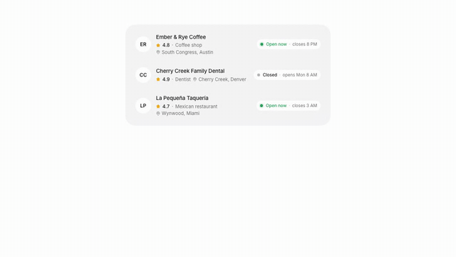</a>

**[Open now badge](https://facadeui.com/components/open-now-badge)**  
Live open or closed pill computed from weekly hours in the business's own time zone.

```bash
npx shadcn@latest add https://facadeui.com/r/open-now-badge.json
```

<a href="https://facadeui.com/components/opening-hours">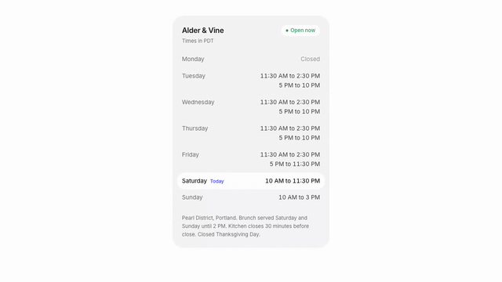</a>

**[Opening hours](https://facadeui.com/components/opening-hours)**  
Weekly hours list with today highlighted, live open status, split shifts and closed days.

```bash
npx shadcn@latest add https://facadeui.com/r/opening-hours.json
```

### hero

<a href="https://facadeui.com/components/hero-agency">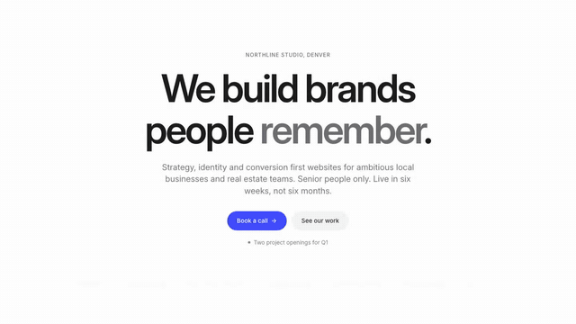</a>

**[Hero, agency](https://facadeui.com/components/hero-agency)**  
Studio hero with oversized centered display type, one ultramarine CTA and a quiet client wordmark marquee.

```bash
npx shadcn@latest add https://facadeui.com/r/hero-agency.json
```

<a href="https://facadeui.com/components/hero-local-business">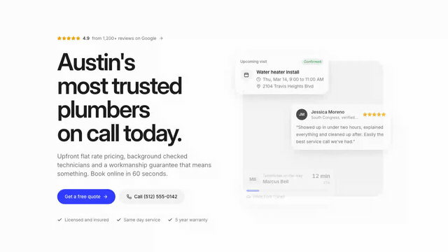</a>

**[Hero, local business](https://facadeui.com/components/hero-local-business)**  
Home services hero with live rating, rotating service words and floating appointment, review and ETA cards.

```bash
npx shadcn@latest add https://facadeui.com/r/hero-local-business.json
```

### sections

<a href="https://facadeui.com/components/faq-section">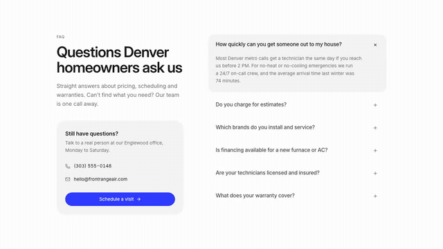</a>

**[FAQ section](https://facadeui.com/components/faq-section)**  
Two-column FAQ with an animated accordion, contact prompt and FAQPage JSON-LD for rich results.

```bash
npx shadcn@latest add https://facadeui.com/r/faq-section.json
```

<a href="https://facadeui.com/components/footer-big">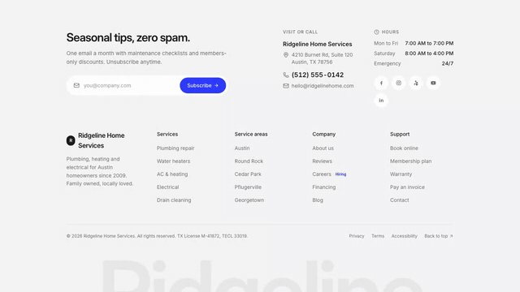</a>

**[Footer, big](https://facadeui.com/components/footer-big)**  
Large local business footer with animated newsletter, link columns, NAP, hours, socials and a giant wordmark.

```bash
npx shadcn@latest add https://facadeui.com/r/footer-big.json
```

<a href="https://facadeui.com/components/logo-cloud">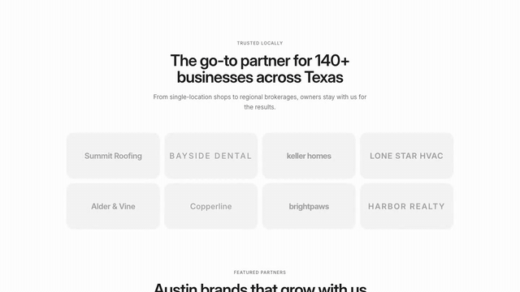</a>

**[Logo cloud](https://facadeui.com/components/logo-cloud)**  
Trusted by wordmark grid with hover reveal of client outcomes and an optional two row marquee mode.

```bash
npx shadcn@latest add https://facadeui.com/r/logo-cloud.json
```

<a href="https://facadeui.com/components/process-steps">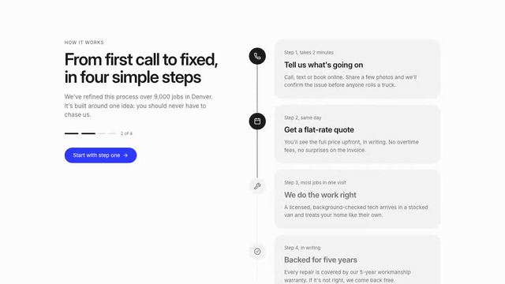</a>

**[Process steps](https://facadeui.com/components/process-steps)**  
How it works section with a line that draws on scroll and steps that light up as you pass them.

```bash
npx shadcn@latest add https://facadeui.com/r/process-steps.json
```

<a href="https://facadeui.com/components/stats-band">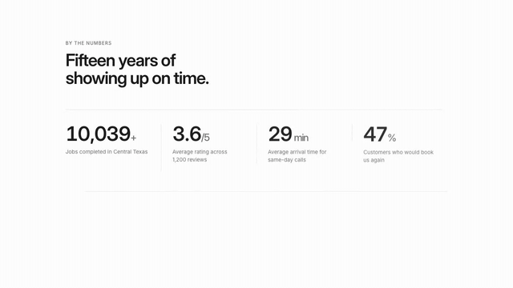</a>

**[Stats band](https://facadeui.com/components/stats-band)**  
Band of four big animated numbers with labels, trends and hairlines that draw in on view.

```bash
npx shadcn@latest add https://facadeui.com/r/stats-band.json
```

<a href="https://facadeui.com/components/team-grid">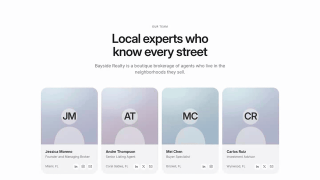</a>

**[Team grid](https://facadeui.com/components/team-grid)**  
Team members grid with gradient initials avatars, bio reveal on hover, social links and a hiring card.

```bash
npx shadcn@latest add https://facadeui.com/r/team-grid.json
```

### conversion

<a href="https://facadeui.com/components/cta-section">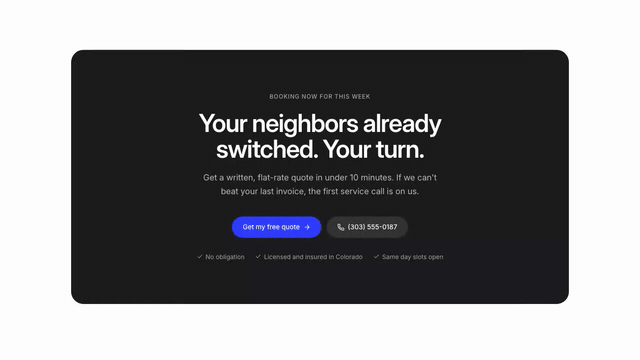</a>

**[CTA section](https://facadeui.com/components/cta-section)**  
Closing CTA panel with headline, two actions and a reassurance line. Dark on light pages, light on dark.

```bash
npx shadcn@latest add https://facadeui.com/r/cta-section.json
```


## Pro

Booking slots, mortgage calculator, valuation funnel, property listing grid, multi step lead form, hotspot floor plans
and 18 more: [https://facadeui.com/pricing](https://facadeui.com/pricing). One-time license, unlimited client projects.

## License

MIT for everything in this repository. Pro items are licensed separately, see https://facadeui.com/legal/license.
